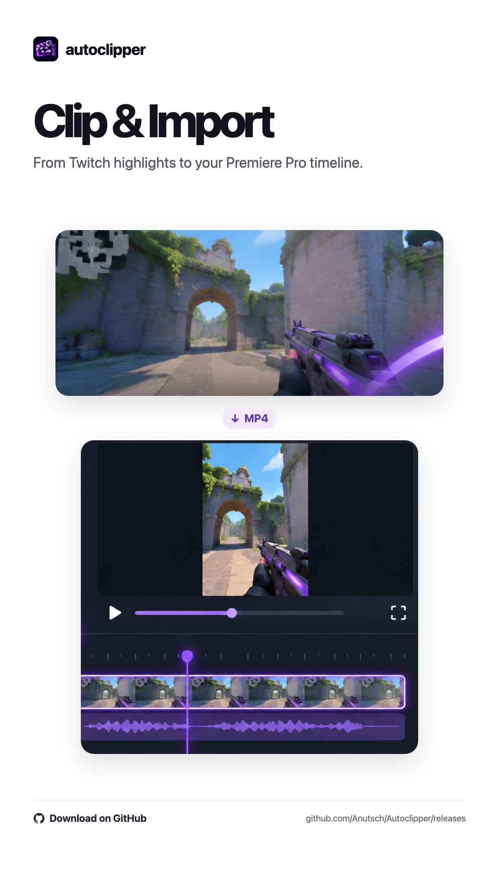
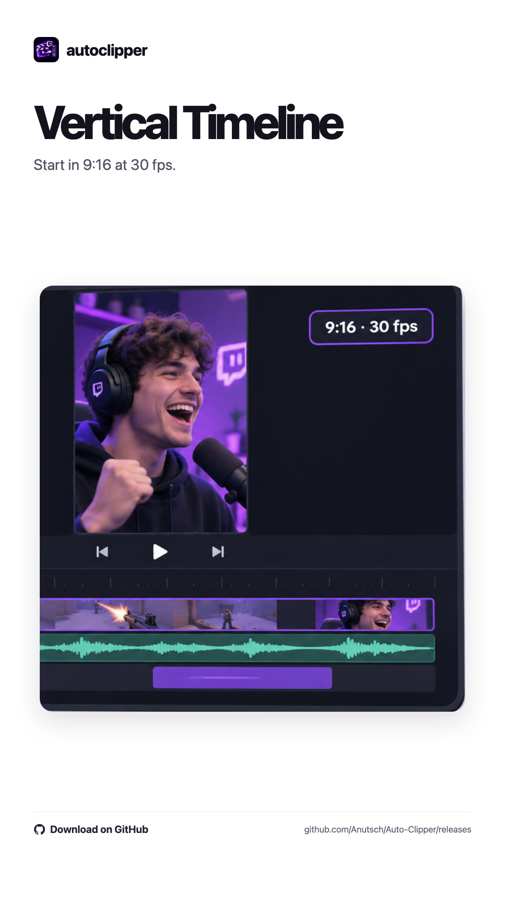
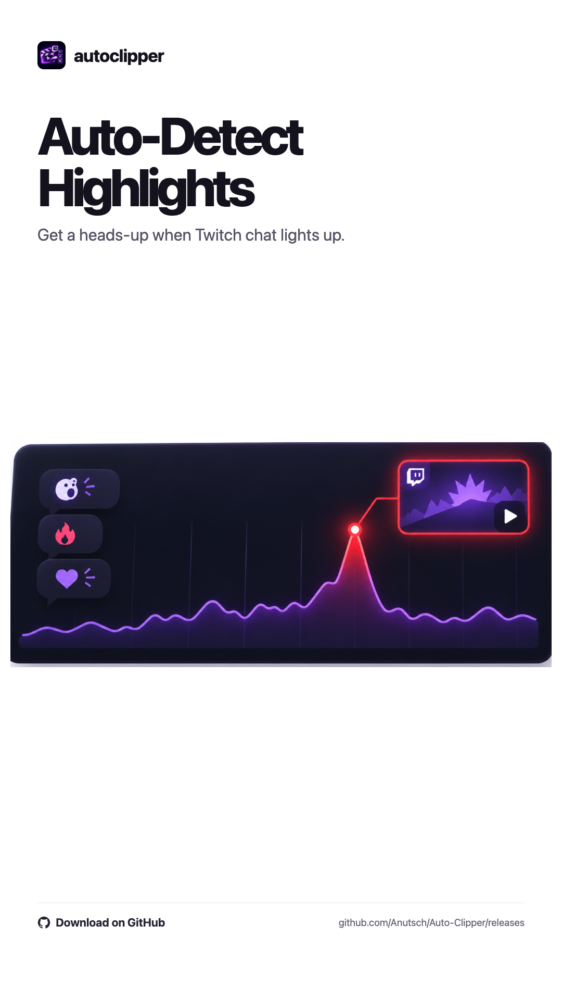
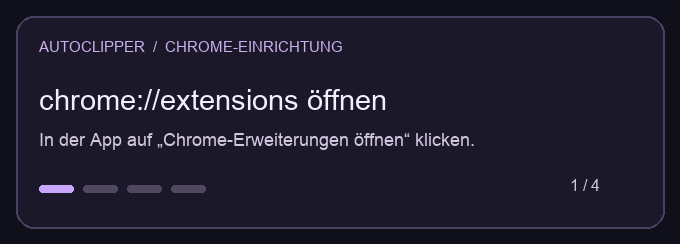

# Auto Clipper

[English](README.md) · [Deutsch](README.de.md) · [Español](README.es.md)

Lokales Tool für Twitch → Adobe Premiere Pro auf macOS und Windows. Chrome sichert die MP4 einer frischen Clip-Vorschau; das Premiere-Panel importiert sie in eine vertikale Sequenz. Es wird kein Twitch-Clip veröffentlicht.

**Downloads** · [macOS-Beta (Apple Silicon)](#eigenständige-macos-beta) · [Windows-Beta (x64)](#eigenständige-windows-beta)

Veröffentlichte Pakete findest du unter [GitHub Releases](https://github.com/Anutsch/Autoclipper/releases).

> **[☕ Autoclipper auf Ko-fi unterstützen](https://ko-fi.com/anutsch)**
>
> Wenn dir Autoclipper beim Schnitt Zeit spart, kannst du die Entwicklung mit einem Kaffee unterstützen.

[Hilfe & Kontakt](SUPPORT.de.md)

**Premiere Pro** ist der Hauptworkflow. **DaVinci Resolve Studio** ist Beta.
Bei **CapCut** zeigt Autoclipper die MP4s zum Reinziehen an.

## Autoclipper im Einsatz

<p align="center">
  <a href="docs/produktbilder/illustrated-9x16/01-clip-import.png"></a>
  <a href="docs/produktbilder/illustrated-9x16/04-vertical-timeline.png"></a>
  <a href="docs/produktbilder/illustrated-9x16/08-auto-detection.png"></a>
</p>

[Alle neun Produktbilder ansehen](docs/produktbilder/illustrated-9x16)

## Aktueller Stand

- Eigenständige Live-Player in der Autoclipper-App mit Pause, Lautstärke und Mute; unabhängig von Chrome.
- Permanente Chrome-Seitenleiste, Stream-Auswahl, Warteschlange und Abbruch.
- Import ins offene Projekt; neue Sequenz je Auswahl, 1080 × 1920 mit 30 fps.
- Bei Mehrfachauswahl: konservativer lokaler Audio-Abgleich und separate Video-/Audiospuren. Unsichere Treffer werden markiert.
- Optionale eigene Overlays und Titel in der App, mit Vorschau und Layouts für TikTok, Reels und Shorts.
- Moment-Score aus Chat-Reaktionen, Emotes und kanalbezogenem Chattempo; Hover-Diagramm und visuelle Alarme.
- Manuelle/optionale automatische Chat-Neuverbindung.
- Kleine Video-Vorschaubilder, Dateiverwaltung über den Papierkorb und löschbare Logs.

## Eigenständige macOS-Beta

`python3 scripts/build_beta.py` erzeugt ein ZIP in `dist/` für die
Architektur des Macs, auf dem es gebaut wird. Die Beta bringt die
Python-Laufzeit und Medienhelfer mit. Tester brauchen Chrome und für
den automatischen Timeline-Import ein unterstütztes Schnittprogramm.

ZIP entpacken und **Autoclipper Beta.app** starten. Beim ersten Start
führt der Assistent durch Sprache, Chrome, Schnittziel und optionale Assets.
Die App merkt sich den Abschluss. Unter **Einstellungen** kannst du alles
später ändern oder den Assistenten erneut öffnen. Dort zeigt die App die Chrome-Verbindung, den Twitch-Stream und
das Schnittziel. Der Knopf für Chrome öffnet den richtigen Ordner und die
Erweiterungsseite. Die Erweiterung muss einmal entpackt geladen werden.
Das Premiere-Panel wird nur über den Installationsknopf eingerichtet.
Eine frühere Panel-Installation wird dabei gesichert.

Die Beta erzeugt ihren Schlüssel beim ersten Start. Ihre Dateien bleiben
unter `~/Library/Application Support/Autoclipper/Beta`. Das ZIP ist lokal
signiert und noch nicht mit Developer ID signiert oder notarisiert.
Für einen öffentlichen Release fehlen diese Freigabe und Tests auf
einem zweiten Mac.

## Eigenständige Windows-Beta

`Autoclipper-1.0.0-beta.1-Windows-x64.zip` entpacken und
`Autoclipper-Beta.cmd` öffnen. Python, FFmpeg und der Papierkorb-Helfer sind
im Paket enthalten. Chrome und dein Schnittprogramm müssen installiert sein.
Der erste vollständige Import auf einem Windows-PC steht noch aus.

Die lokalen Pakete lassen sich mit `python3 scripts/build_beta.py` auf einem
Mac und `python3 scripts/build_windows_beta.py` erstellen. Der GitHub-Workflow
**Autoclipper Beta Release** erstellt nach beiden Builds einen Release-Entwurf.
Für ein notarisiertes Mac-Paket benötigt der Mac eine Developer-ID im
Schlüsselbund und ein `notarytool`-Profil. Setze dafür beim Build
`AUTOCLIPPER_DEVELOPER_ID` und `AUTOCLIPPER_NOTARY_PROFILE`. Das macOS-Artefakt
aus dem Standardworkflow ist nur lokal signiert.

Die [Testanleitung für fünf Editoren](docs/beta-test.de.md) enthält die
Nachricht für den Beta-Link und Fragen zum ersten Import.

## Installation aus dem GitHub-Download

Unter macOS `Setup.command` öffnen. Unter Windows `Setup.cmd` öffnen.
Die Voraussetzungen stehen in den folgenden Abschnitten. Das Setup
installiert Autoclipper im Benutzerordner und fragt, ob es das
Premiere-Panel mitinstallieren soll. Ein vorhandener lokaler Schlüssel
bleibt beim erneuten Setup erhalten.

Das Setup öffnet Autoclipper und die Erweiterungsseite in Chrome. Dort einmal **Entwicklermodus**
einschalten und unter **Entpackte Erweiterung laden** den vom Setup
angezeigten Ordner wählen. Der Starter der App liegt im selben
Installationsordner. Bei späteren Updates im Erweiterungsmenü einmal
auf **Neu laden** klicken.



## Build auf macOS

Benötigt macOS, Python 3, Xcode Command Line Tools, Google Chrome und Premiere Pro 2025/2026 mit CEP-Unterstützung. Keine externen Python-Pakete nötig.

```sh
python3 scripts/build.py
```

Der Build liegt unter `dist/Auto Clipper/`. Der lokal erzeugte Pairing-Token bleibt bei erneuten Builds erhalten. Dieser Ordner enthält lokale Zugangsdaten und gehört nicht ins Repository.

1. `dist/Auto Clipper/Autoclipper.app` öffnen.
2. In `chrome://extensions` den Entwicklermodus einschalten und `dist/Auto Clipper/Chrome-Erweiterung` als entpackte Erweiterung laden.
3. Das Premiere-Panel installieren:

   ```sh
   python3 scripts/install_panel.py
   ```

4. In Premiere unter **Fenster → Erweiterungen → Autoclipper** öffnen. Für ein unsigniertes lokales CEP-Panel kann die passende Adobe-Entwicklereinstellung nötig sein. Vorhandene Projekte vor einem Premiere-Neustart speichern.

App, Chrome-Erweiterung und Premiere-Panel müssen aus demselben Build stammen. Die App neben `src/`, `assets/` und `config.json` im Build-Ordner belassen.

## Build auf Windows

Benötigt Windows 10 oder 11, Chrome, Python 3 mit dem Windows-Launcher
`py` und FFmpeg im `PATH`. In PowerShell im Repo-Ordner:

```powershell
py -3 -m pip install Send2Trash
py -3 scripts/build.py
```

1. `dist/Auto Clipper/Autoclipper.cmd` öffnen. Die gewohnte Oberfläche
   erscheint in einem eigenen Chrome-App-Fenster.
2. In `chrome://extensions` den Entwicklermodus einschalten und
   `dist/Auto Clipper/Chrome-Erweiterung` entpackt laden.
3. Für Premiere Pro `py -3 scripts/install_panel.py` ausführen und
   das Panel unter **Fenster → Erweiterungen → Autoclipper** öffnen.
   Falls Premiere das unsignierte CEP-Panel ausblendet, ist
   [Adobes CEP-Entwicklereinstellung](https://github.com/Adobe-CEP/CEP-Resources/blob/master/CEP_12.x/Documentation/CEP%2012%20HTML%20Extension%20Cookbook.md)
   für die installierte CEP-Version erforderlich.

FFmpeg liefert die Vorschaubilder und Audiodaten für den lokalen Abgleich.
Der Build erzeugt einen eigenen lokalen Verbindungsschlüssel. Der echte
Import in die Windows-Schnittprogramme ist noch nicht Ende zu Ende geprüft.

[Audio-Synchronisation](docs/audio-sync.de.md) · [Moment-Score](docs/moment-score.de.md) · [Windows-Drittanbieter](docs/third-party-windows.de.md)

## Struktur

| Ordner | Inhalt |
| --- | --- |
| `src/` | Python-Dienst, App-Oberfläche und Medien-Helfer |
| `Chrome-Erweiterung/` | Twitch-Erkennung, Clip-Steuerung und Chat-Analyse |
| `Premiere-Panel/` | CEP-Oberfläche und ExtendScript-Import |
| `assets/`, `packaging/` | Logo und App-Paketvorlage |
| `docs/` | Technische Hinweise zur Audio-Synchronisation und zum Moment-Score |

## Eigene Clip-Gestaltung

In der Autoclipper-App unter **Einstellungen → Titel & automatische Assets** öffnen. Dort lassen sich bis zu sechs
eigene MOV-, MP4-, PNG- oder JPG-Dateien auswählen. Die App speichert eine lokale Kopie im Projektordner und zeigt ein kleines Vorschaubild. In Premiere und Resolve Studio werden die Overlays ab Sequenzbeginn auf eigenen Videospuren platziert. In CapCut ziehst du Clips und Overlays aus dem Ordner, den Autoclipper nach dem Download öffnet.

Der Titel-Editor unterstützt installierte Schriftarten, Schriftschnitt, Größe,
Füllung, Kontur, Position und Dauer. Premiere zeigt zusätzlich Schatten, Resolve Schatten und horizontale Ausrichtung, CapCut einen Texthintergrund. Die 9:16-Vorschau steht rechts. TikTok, Reels und Shorts haben verschiedene
Startpositionen und Ränder für ihre Bedienelemente. Der Titel wird als
transparente 1080 × 1920 PNG-Grafik oberhalb der Overlays eingefügt.
Er lässt sich in der Autoclipper-App gestalten. Premiere behandelt ihn als
Bilddatei.

**Für alle neuen Clips speichern** gilt für neue Aufträge. Aktiviere **Bei neuen
Clips auf Gestaltung warten**, wenn du während des Downloads am Titel
arbeiten willst. Danach **Für aktuellen Clip übernehmen** oder **Ohne
Gestaltung importieren** wählen. Ohne gespeicherten Standard startet jeder
Import mit den Originalclips.

## Auto Cam Detection

Der Schalter sitzt unter **Einstellungen → Automatik** und ist anfangs aus. Bei
unsicherer Erkennung kannst du den Ausschnitt in der Vorschau ziehen oder
ohne Cam importieren. Bei mehreren Ansichten wird die erste Ansicht für
die Cam verwendet. Premiere und Resolve Studio erhalten den stummen,
zugeschnittenen Kamera-Clip auf einer eigenen Spur mit mittigem
Ankerpunkt. Für CapCut liegen Original und Kamera-Datei im
Übergabeordner. Ziehe die Kamera-Datei auf eine Spur über dem Original.

Die Mac-Version verwendet Vision. Die gepackte Windows-Beta verwendet
OpenCV und FFmpeg. Beim Windows-Build aus dem Quellcode kann OpenCV mit
`py -3 -m pip install opencv-python-headless` ergänzt werden. Ohne OpenCV
steht dort die manuelle Ausschnittwahl zur Verfügung.

## Grenzen

Clippen verwendet weiterhin die Twitch-Clip-Vorschau des verbundenen Chrome-Tabs, nicht den unabhängigen Wiedergabepunkt im App-Player. Der Moment-Score benötigt geladenen Chat. Audio-Synchronisation braucht ausreichend gemeinsame Audiosignale; zusätzliche Premiere-Spuren verwenden die interne QE-Schnittstelle. Der letzte Synchronisationsumbau wurde noch nicht vollständig in Premiere live getestet.

Die automatische Transkription mit Ein-Wort-Untertiteln und Transkript-Stil ist **noch nicht implementiert**. Der Titel-Zusatz für synchronisierte Gruppen ist vorlagenbasiert eingebaut; ein Premiere-Live-Test steht noch aus.

Clips, Premiere-Projekte, Laufzeitdaten, Logs, Pairing-Tokens und kompilierte App-Bundles werden nicht versioniert. Der bestehende Desktop-Ordner wird vom Build nicht verändert.

### Schnittziel automatisch erkennen

In der App lässt sich das Schnittziel in den Einstellungen wählen. Die Einstellung gilt für neue Aufträge.
Im Modus **Auto** wählt Autoclipper beim Start eines Clip-Auftrags das laufende Schnittprogramm.
Sind mehrere geöffnet, gilt die Reihenfolge Premiere Pro, DaVinci Resolve, CapCut.
Ist keines geöffnet, bleibt der automatische Premiere-Start der Standard.

- **DaVinci Resolve Studio:** Unter Preferences → System → General die Option
  „External scripting using“ auf „Local“ setzen und ein Projekt öffnen.
  Autoclipper legt die Clips in einer neuen vertikalen Timeline (1080 × 1920,
  30 fps) ab. Mehrere Ansichten liegen hintereinander. Audio-Synchronisation,
  Titel und eigene Overlays werden auf separaten Videospuren platziert.
- **CapCut:** Autoclipper zeigt die MP4s im Finder oder Windows-Explorer. Von dort lassen sie sich in CapCut ziehen.
