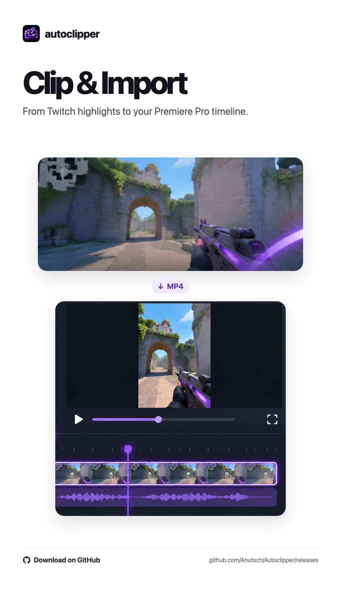
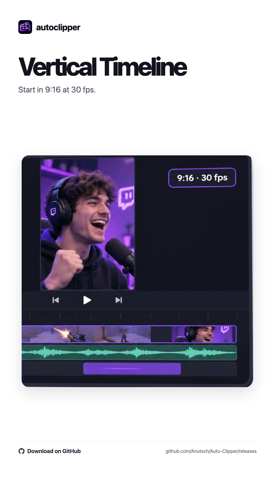
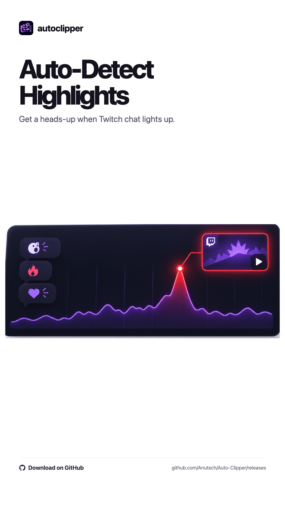
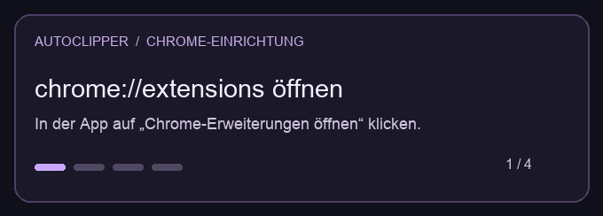

# Auto Clipper

[English](README.md) · [Deutsch](README.de.md) · [Español](README.es.md)

Autoclipper es una herramienta local de edición para Twitch en macOS y Windows. Descarga el MP4 de una vista previa nueva sin publicar un clip en Twitch. **Premiere Pro** es el flujo principal, **DaVinci Resolve Studio** está en beta y **CapCut** permite arrastrar los archivos al editor.

**Descargas** · [GitHub Releases](https://github.com/Anutsch/Autoclipper/releases) · [Beta para macOS](#beta-independiente-para-macos) · [Beta para Windows](#beta-independiente-para-windows)

[Soporte y donaciones](SUPPORT.es.md) · [Ko-fi](https://ko-fi.com/anutsch)

## Autoclipper en acción

<p align="center">
  <a href="docs/produktbilder/illustrated-9x16/01-clip-import.png"></a>
  <a href="docs/produktbilder/illustrated-9x16/04-vertical-timeline.png"></a>
  <a href="docs/produktbilder/illustrated-9x16/08-auto-detection.png"></a>
</p>

[Ver las nueve imágenes del producto](docs/produktbilder/illustrated-9x16)

## Funciones

- Ve directos en la app con controles independientes de pausa, volumen y silencio.
- Selecciona directos en la barra lateral de Chrome, pon clips en cola y cancela tareas.
- Importa al proyecto abierto de Premiere en una secuencia nueva de 1080 × 1920 a 30 fps. Las vistas múltiples usan pistas separadas y sincronización local por audio.
- Añade tus propios títulos y recursos con vistas previas y diseños para TikTok, Reels y Shorts.
- Consulta las alertas y gráficas del [Moment Score](docs/moment-score.es.md). Reconecta los chats de forma manual o automática.
- Previsualiza los clips descargados, muévelos a la papelera y borra los registros.

## Beta independiente para macOS

Ejecuta `python3 scripts/build_beta.py` para crear en `dist/` un ZIP para la arquitectura del Mac que realiza la compilación. Incluye Python y las utilidades multimedia. Instala Chrome y un editor compatible para la importación automática.

Descomprime el ZIP y abre **Autoclipper Beta.app**. El asistente inicial te guía por el idioma, Chrome, el editor y los recursos opcionales. Puedes cambiar estas opciones en **Configuración** y volver a abrir el asistente. Usa el botón de configuración de Chrome para localizar y cargar la extensión una vez. El panel de Premiere se instala con su propio botón, que guarda una copia de cualquier instalación anterior.

La app genera una clave local en el primer inicio y guarda sus archivos en `~/Library/Application Support/Autoclipper/Beta`. La compilación estándar lleva una firma local. Para distribuirla públicamente aún faltan la firma con Developer ID, la notarización y una prueba en otro Mac.

## Beta independiente para Windows

Descomprime `Autoclipper-1.0.0-beta.1-Windows-x64.zip` y ejecuta `Autoclipper-Beta.cmd`. Incluye Python, FFmpeg y la utilidad de papelera. Instala Chrome y el editor por separado. Aún está pendiente una prueba completa de importación en Windows.

Puedes compilar con `python3 scripts/build_windows_beta.py`. El flujo de GitHub **Autoclipper Beta Release** crea un borrador tras ambas compilaciones. Para notarizar el paquete de Mac, añade una identidad Developer ID al llavero y configura `AUTOCLIPPER_DEVELOPER_ID` y `AUTOCLIPPER_NOTARY_PROFILE` al compilar.

Consulta la [guía de pruebas](docs/beta-test.es.md) y los [avisos de terceros de Windows](docs/third-party-windows.es.md).

## Instalación desde la descarga de GitHub

Ejecuta `Setup.command` en macOS o `Setup.cmd` en Windows. El instalador usa tu carpeta de usuario, conserva la clave local y ofrece instalar el panel de Premiere.

Abre `chrome://extensions`, activa **Modo de desarrollador** y elige la carpeta indicada por el instalador con **Cargar descomprimida**. Tras una actualización, vuelve a cargar la extensión en esa página. El acceso a la app está en la carpeta de instalación.



## Compilación en macOS

Requiere Python 3, las herramientas de línea de comandos de Xcode y Chrome. El flujo de Premiere requiere Premiere Pro 2025/2026 con CEP.

```sh
python3 scripts/build.py
```

1. Abre `dist/Auto Clipper/Autoclipper.app`.
2. En `chrome://extensions`, carga la extensión descomprimida desde `dist/Auto Clipper/Chrome-Erweiterung`.
3. Para Premiere, ejecuta `python3 scripts/install_panel.py`.
4. En Premiere, abre **Ventana → Extensiones → Autoclipper**. Un panel CEP sin firmar puede requerir el ajuste de desarrollo de Adobe. Guarda los proyectos abiertos antes de reiniciar Premiere.

Conserva la app junto a `src/`, `assets/` y `config.json`. Usa la app, la extensión y el panel de la misma compilación. Mantén la clave local y la carpeta de compilación fuera de Git.

## Compilación en Windows

Requiere Windows 10 u 11, Chrome, Python 3 con el lanzador `py` y FFmpeg en `PATH`. Ejecuta en PowerShell desde el repositorio:

```powershell
py -3 -m pip install Send2Trash
py -3 scripts/build.py
```

1. Abre `dist/Auto Clipper/Autoclipper.cmd` para iniciar la interfaz en una ventana de aplicación de Chrome.
2. Carga la extensión descomprimida desde `dist/Auto Clipper/Chrome-Erweiterung`.
3. Para Premiere, ejecuta `py -3 scripts/install_panel.py` y abre **Ventana → Extensiones → Autoclipper**. Un panel sin firmar puede requerir el [ajuste de desarrollo de Adobe CEP](https://github.com/Adobe-CEP/CEP-Resources/blob/master/CEP_12.x/Documentation/CEP%2012%20HTML%20Extension%20Cookbook.md) de tu versión.

FFmpeg genera las miniaturas y extrae audio para la sincronización local. La compilación genera su propia clave de conexión.

## Estructura del repositorio

| Carpeta | Contenido |
| --- | --- |
| `src/` | Servicio local, interfaz y utilidades multimedia |
| `Chrome-Erweiterung/` | Detección de Twitch, controles de clips y análisis del chat |
| `Premiere-Panel/` | Interfaz CEP e importación mediante ExtendScript |
| `assets/`, `packaging/` | Identidad visual y empaquetado |
| `docs/` | Guía beta, notas técnicas y avisos de terceros |

## Títulos y recursos

Abre **Configuración → Títulos y recursos automáticos**. Puedes añadir hasta seis archivos MOV, MP4, PNG o JPG. Autoclipper guarda copias locales y muestra miniaturas. Premiere y Resolve Studio colocan los recursos en pistas de vídeo separadas al inicio de la secuencia. En CapCut, arrastra los clips y recursos desde la carpeta que abre Autoclipper.

El inspector permite elegir fuente instalada, peso, tamaño, relleno y contorno. También ofrece sombra para Premiere, sombra y alineación horizontal para Resolve y fondo de texto para CapCut. La vista previa 9:16 queda a la derecha. TikTok, Reels y Shorts tienen distintas posiciones iniciales y márgenes. El título se exporta como PNG transparente de 1080 × 1920 sobre los recursos.

Puedes guardar el diseño para los próximos clips o activar la espera para aplicarlo al clip actual antes de importar. Si no hay diseño guardado, se usan los clips originales.

## Detección automática de cámara

Actívala en **Configuración → Automatización**. Si la detección no es clara, ajusta el recorte en la vista previa o importa sin cámara. En un grupo se utiliza la primera vista. Premiere y Resolve Studio reciben un clip de cámara recortado, silenciado y con el punto de anclaje centrado en una pista independiente. En CapCut, arrastra el archivo de cámara a una pista superior.

macOS usa Vision. La beta empaquetada de Windows usa OpenCV y FFmpeg. Al compilar desde el código fuente en Windows puedes instalar OpenCV con `py -3 -m pip install opencv-python-headless`. Sin OpenCV puedes definir el recorte manualmente.

## Selección de editor

Elige el editor en **Configuración**. En modo **Auto**, Autoclipper usa el editor abierto al iniciar la tarea. Si hay varios, prioriza Premiere Pro, DaVinci Resolve y CapCut, en ese orden. Si no hay ninguno, inicia Premiere.

- **DaVinci Resolve Studio:** En **Preferences → System → General → External scripting using**, elige **Local** y abre un proyecto. Autoclipper crea una línea de tiempo vertical de 1080 × 1920 a 30 fps con pistas para los títulos y recursos.
- **CapCut:** Autoclipper abre los archivos en Finder o el Explorador para que los arrastres al editor.

## Límites

La captura usa la vista previa del clip de la pestaña de Twitch conectada. El reproductor independiente de la app no determina el punto de captura. El Moment Score necesita un chat cargado. La [sincronización por audio](docs/audio-sync.es.md) requiere señales comunes y las pistas adicionales de Premiere usan la interfaz interna QE. Los últimos cambios de sincronización y títulos requieren una prueba completa en Premiere. La transcripción automática con subtítulos de una palabra y estilo de transcripción está pendiente.

Los clips, proyectos, datos de ejecución, registros, claves y paquetes compilados quedan fuera de Git. Compilar desde el código fuente no modifica la instalación existente en el escritorio.
