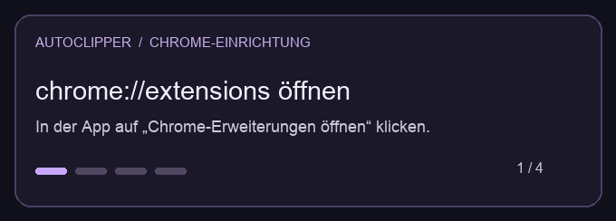

# Auto Clipper

[English](README.md) · [Deutsch](README.de.md) · [Español](README.es.md)

Autoclipper is a local Twitch editing tool for macOS and Windows. It downloads the MP4 from a fresh Twitch clip preview without publishing a clip on Twitch. **Premiere Pro** is the main workflow, **DaVinci Resolve Studio** is in beta, and **CapCut** uses a drag-and-drop handoff.

**Downloads** · [GitHub Releases](https://github.com/Anutsch/Auto-Clipper/releases) · [macOS beta](#standalone-macos-beta) · [Windows beta](#standalone-windows-beta)

[Support & donations](SUPPORT.md) · [Ko-fi](https://ko-fi.com/anutsch)

## Features

- Watch streams in the app with independent pause, volume and mute controls.
- Select streams in Chrome’s persistent sidebar, queue clips and cancel jobs.
- Import into the open Premiere project in a new 1080 × 1920 sequence at 30 fps. Multiple views use separate tracks and conservative local audio alignment.
- Add your own overlays and titles with previews and layouts for TikTok, Reels and Shorts.
- See [Moment Score](docs/moment-score.md) alerts and chat trends. Reconnect chats manually or automatically.
- Preview downloaded clips, move them to the Trash or Recycle Bin, and clear logs.

## Standalone macOS beta

Run `python3 scripts/build_beta.py` to create a ZIP in `dist/` for the architecture of the Mac running the build. The package includes Python and media utilities. Install Chrome and an editor for automatic timeline import.

Extract the ZIP and open **Autoclipper Beta.app**. The first-run guide walks through language, Chrome, editor and optional assets. You can change these in **Settings** or reopen the guide later. Use the Chrome setup button to find the unpacked extension folder and load it once. Use the separate install button to install the Premiere panel. It backs up any previous panel installation.

The app generates a local pairing key on first launch and stores its files under `~/Library/Application Support/Autoclipper/Beta`. The standard build is locally signed. Public macOS distribution still needs Developer ID signing, notarisation and testing on a second Mac.

## Standalone Windows beta

Extract `Autoclipper-1.0.0-beta.1-Windows-x64.zip` and run `Autoclipper-Beta.cmd`. The package includes Python, FFmpeg and the Recycle Bin helper. Install Chrome and your editor separately. A complete Windows import still needs testing.

Build locally with `python3 scripts/build_windows_beta.py`. The **Autoclipper Beta Release** GitHub workflow creates a release draft after both builds. For a notarised Mac package, put a Developer ID identity in Keychain and set `AUTOCLIPPER_DEVELOPER_ID` and `AUTOCLIPPER_NOTARY_PROFILE` for the build.

See the [beta test guide](docs/beta-test.md) and [Windows third-party notices](docs/third-party-windows.md).

## Install from the GitHub download

Run `Setup.command` on macOS or `Setup.cmd` on Windows. The setup installs in your user folder, retains an existing pairing key and offers to install the Premiere panel.

In `chrome://extensions`, turn on **Developer mode** and select the folder shown by setup using **Load unpacked**. After an update, reload the extension on that page. The app launcher is in the installation folder.



## Build on macOS

Requires Python 3, Xcode Command Line Tools and Chrome. The Premiere workflow uses Premiere Pro 2025/2026 with CEP support.

```sh
python3 scripts/build.py
```

1. Open `dist/Auto Clipper/Autoclipper.app`.
2. In `chrome://extensions`, load `dist/Auto Clipper/Chrome-Erweiterung` as an unpacked extension.
3. Run `python3 scripts/install_panel.py` for Premiere.
4. Open **Window → Extensions → Autoclipper** in Premiere. An unsigned CEP panel may require Adobe’s developer setting. Save open projects before restarting Premiere.

Keep the app next to `src/`, `assets/` and `config.json`. Use the app, extension and panel from the same build. Keep the generated pairing key and build folder out of Git.

## Build on Windows

Requires Windows 10 or 11, Chrome, Python 3 with the `py` launcher and FFmpeg on `PATH`. Run in PowerShell from the repository:

```powershell
py -3 -m pip install Send2Trash
py -3 scripts/build.py
```

1. Open `dist/Auto Clipper/Autoclipper.cmd` to launch the desktop interface in a Chrome app window.
2. Load the unpacked extension from `dist/Auto Clipper/Chrome-Erweiterung`.
3. Run `py -3 scripts/install_panel.py` for Premiere, then open **Window → Extensions → Autoclipper**. An unsigned panel may require the [Adobe CEP developer setting](https://github.com/Adobe-CEP/CEP-Resources/blob/master/CEP_12.x/Documentation/CEP%2012%20HTML%20Extension%20Cookbook.md) for your CEP version.

FFmpeg provides thumbnails and audio data for local alignment. The build generates its own pairing key.

## Repository layout

| Folder | Contents |
| --- | --- |
| `src/` | Local service, desktop interface and media utilities |
| `Chrome-Erweiterung/` | Twitch detection, clip controls and chat analysis |
| `Premiere-Panel/` | CEP interface and ExtendScript import |
| `assets/`, `packaging/` | Branding and application packaging |
| `docs/` | Beta guide, technical notes and third-party notices |

## Titles and overlays

Open **Settings → Titles & automatic assets**. You can choose up to six MOV, MP4, PNG or JPG files. Autoclipper stores local copies and shows thumbnails. Premiere and Resolve Studio place overlays on separate video tracks from the start of the sequence. In CapCut, drag the clips and overlays from the folder that Autoclipper opens.

The inspector supports installed fonts, font weight, size, fill and outline. It also offers shadow for Premiere, shadow and horizontal alignment for Resolve, and a text background for CapCut. The 9:16 preview is on the right. TikTok, Reels and Shorts use different starting positions and margins. The title is rendered as a transparent 1080 × 1920 PNG above the overlays.

Save the design for future clips, or turn on the option to wait for a design and apply it to the current clip before import. Without a saved design, imports use the original clips.

## Auto Cam Detection

Enable it under **Settings → Automation**. You can adjust an uncertain crop in the preview or import without the camera. For a group, the first view supplies the camera. Premiere and Resolve Studio receive a separate, muted, cropped clip with a centred anchor point. In CapCut, drag the camera file onto a track above the original.

macOS uses Vision. The packaged Windows beta uses OpenCV and FFmpeg. For a Windows source build, install OpenCV with `py -3 -m pip install opencv-python-headless`. Manual crop selection is available without it.

## Editor selection

Choose the editor under **Settings**. **Auto** uses the editor running when a job starts. With several open, the order is Premiere Pro, DaVinci Resolve, then CapCut. If none is open, Autoclipper starts Premiere.

- **DaVinci Resolve Studio:** Set **Preferences → System → General → External scripting using** to **Local** and open a project. Autoclipper creates a vertical 1080 × 1920 timeline at 30 fps with title and overlay tracks.
- **CapCut:** Autoclipper opens the files in Finder or File Explorer for drag-and-drop into the editor.

## Limits

Capture uses the clip preview from the connected Twitch tab. The independent player in the desktop app does not determine the capture point. The Moment Score needs a loaded chat. [Audio alignment](docs/audio-sync.md) needs shared audio, and additional Premiere tracks use the internal QE interface. The latest sync and title changes still need a complete live Premiere test. Automatic transcription with single-word captions and transcript styling is pending.

Clips, projects, runtime data, logs, pairing keys and built app bundles are excluded from Git. Source builds leave the existing Desktop installation alone.
